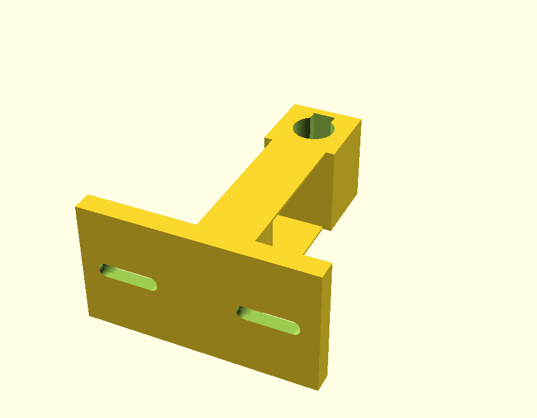

# homework-plotter

Learns your handwriting from one sample sheet, reads a homework sheet from a
photo, works out the answers, and writes them back onto the paper in your
handwriting using a pen clipped to a 3D printer.

```
template ─► (you fill it in) ─► learn ─► hand.json
homework photo ─► solve ─► answers.json ─► render ─► preview.png / answers.svg / answers.gcode ─► printer
```

## Setup

```bash
cd homework-plotter
python3 -m pip install -r requirements.txt
export ANTHROPIC_API_KEY=...   # only `solve` / `run` need it
```

## The easy way: the local web page

```bash
python3 -m hwplot serve
```

This opens http://localhost:8000. It walks you through everything below step by
step: what to print and photograph, which pen-holder file to print, the
printer settings, and uploading the homework. It makes all the files there and
lets you fix answers and redraw before printing. Everything it makes is kept in
`workspace/`. It only listens on your own computer.

The rest of this README is the same flow from the command line.

## 1. Teach it your handwriting

```bash
python3 -m hwplot template            # -> handwriting-template.pdf (2 pages)
```

Print it **at 100% / actual size**. Write one character in each box, sitting on
the tick marks, **with the pen you will put in the printer**. Every character
is on the sheet twice, so the output alternates between your two versions and
doesn't look stamped. Photograph or scan both pages (any angle is fine, as long
as all four black corner squares are in the shot), then:

```bash
python3 -m hwplot learn page1.jpg page2.jpg     # -> hand.json
```

It warns about any box it found empty. Redo just that page if you need to.

## 2. Answer a sheet

```bash
python3 -m hwplot run homework.jpg --fit
```

That runs both halves. Separately:

- `solve homework.jpg` finds the page in the photo, flattens it, and sends it to
  Claude, which reads each question, solves it, and says where the answer goes.
  The result is written to `out/answers.json`, with a confidence on each answer.
- `render` lays the answers out in your handwriting and writes:
  - `out/preview.png`: the sheet with the answers drawn on. **Check this first.**
  - `out/answers.svg`: just the answers, at true page size. This is the "file of
    answers in place": you can also send it to any SVG pen plotter or Cricut.
  - `out/answers.gcode`: the job for the printer.

If an answer is wrong or sits in the wrong spot, edit `out/answers.json` (each
`box` is `[x, y, width, height]` in mm from the page's top-left corner) and
run `render` again. No new API call is needed. `--size 4` writes smaller,
`--seed 3` gives a different random mix of your letter variants, and
multiple-choice answers are circled instead of written.

## 3. The printer

### Print the pen holder

Ready-made STLs in `hardware/stl/` (source: `hardware/pen_holder.scad`):

| File | For |
|---|---|
| `pen_holder_8mm.stl` | pencils (hex or round), mechanical pencils |
| `pen_holder_10mm.stl` | most ballpoint and gel pens |
| `pen_holder_12mm.stl` | markers, chunky pens |
| `pen_holder_pilot_g2.stl` | Pilot G2 gel pens: an 11.0 mm hole sized for its 10.5 mm rubber grip |



It's one printed part with no springs to buy. Two thin parallel leaves let the
pen ride up a couple of millimetres when it touches the paper, so the pressure
stays light and even. To set it up:

1. **Measure your pen's barrel** where it'll be clamped and pick the closest
   STL. For another size, set `pen_d` in the `.scad` in OpenSCAD and export,
   or use "Make STL" on the web page.
2. Print it in PLA or PETG at 0.2 mm layers with no supports.
3. Push an M3 nut into the slot on top of the clamp block, then use an M3 screw
   to grip the pen.
4. Bolt the plate to your toolhead with two screws through the slots. The
   slots fit any hole spacing from 22 to 44 mm, and the plate is only 1.5 mm
   thick under each screw head, so the screws already holding a cover on the
   print head are usually long enough to reuse.
5. Slide the pen down so its tip sits **about 2 mm below the nozzle**. That
   gives the pen first contact, and the flexure absorbs homing.

### Calibrate once

```bash
cp printer.example.json printer.json
```

- `bed_x`, `bed_y`: your bed size.
- `pen_offset_x/y`: how far the pen tip is from the nozzle, in mm. To find it,
  move the nozzle to X100 Y100, lower until the pen marks the paper, and
  measure where the dot landed relative to the X100 Y100 point.
- `z_down`: lower Z by hand until the pen just draws a clean line, then go about
  0.5 mm further for the flexure. `z_up` is 3 mm above that.
- `pause`: `M0` for Marlin with a screen. Use `PAUSE` on Klipper.

### Run it

`render` prints where the paper goes, for example "top-left corner under the
pen at bed X12.3 Y241.0". A Letter page is taller than most beds, so it usually
overhangs. That's fine, because `--fit` centres the *answers* on the bed. Tape
the page down. The G-code homes, moves the pen over the paper's corner (when
that's on the bed) and pauses so you can line the paper up. Then it writes.

The G-code refuses to generate if any stroke falls outside the bed, rather
than driving the head into the frame.

## Limits worth knowing

- **Check the preview.** Claude is good at homework, but a misread photo means
  a confidently wrong answer in ink. Low-confidence answers are flagged.
- Answer boxes are placed from the photo. They are usually right, and a printed
  underline in the box is snapped to automatically, but a blank with no line
  can land a few mm off.
- It writes only characters you gave it samples for. A character it has no
  sample for is skipped, with a warning.
- Glyphs are centre-line traces of your scan, so a felt tip gives cleaner
  samples than a pen that skips.
- Bambu printers don't take raw G-code jobs the same way. This targets Marlin
  and Klipper machines (Ender, Prusa, Voron and similar).

## Tests

```bash
python3 -m pytest -q tests
```

The tests build a fake filled-in sample sheet, photograph it at an angle,
learn from it, and check the layout and G-code. They don't need a pen or an
API key.
